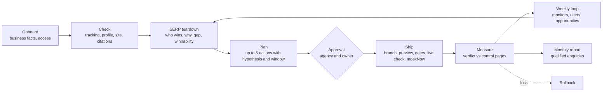

# twwa-growth

**A Claude Code plugin that works a local business website toward first place for its money queries, in Google's organic results, in the map pack and in AI answers, and counts the result in enquiries.**

Built by [The White Whale Agency](https://github.com/The-White-Whale-Agency) for German small and mid-sized businesses (trades, tax and financial advisers, engineers, property managers, hauliers, driving schools, restaurants) whose sites run on Astro and Vercel. Everything it produces for a client is German; the plugin itself is documented in English.

It is not an article generator. It finds out who currently wins each query and why, closes the largest gap with one small change at a time, and checks afterwards whether the change worked.

## What it does

- **SERP teardown.** For each target query (service and town, cost, specific need, "best ...") it observes the top three in the organic results, the map pack and the AI answers, collects why they win (page type, intent match, depth and evidence, internal links, referring domains, profile category, reviews, proximity, schema, speed, age), scores the gap against the client and says how winnable the query is.
- **A plan of at most five actions.** Each has a hypothesis, one metric, a measurement window, control pages, the owner's effort in minutes and a risk class.
- **Shipping with gates.** Branch, Vercel preview, gate scripts, approval bound to the exact content, merge, live verification, IndexNow ping, log entry. Every change can be rolled back with one command.
- **Pages that carry evidence.** New pages need real demand, a real service relationship with the town, at least three local evidence items from the client's monthly project reports, and must pass a town-swap test, a similarity cap and a publishing ramp. Every factual sentence traces to a project record or a dated source.
- **Google Business Profile.** Reads information, performance, reviews, posts and media for every profile the agency manages; writes review replies, posts and info edits only after approval.
- **Measurement.** Search Console, Bing Webmaster, Vercel Web Analytics, lead records without personal data, a local rank grid and a multi-run AI prompt panel. Each action gets a verdict at the end of its window, including "too early to tell".
- **Monitors.** Weekly self-crawl, rank and grid tracking, AI-answer tracking, crawler logs (which bot fetched which URL, time to first crawl), competitor change detection, regression guard.
- **A one-page monthly report** in German that starts with qualified enquiries and compares them with what the same number would cost on a lead portal.
- **A free check for prospects** on any public URL, without repository access or credentials.

## How it works



State lives in the client repository under `.twwa-growth/`: business facts, target queries, teardowns, backlog, action log, approvals, snapshots, reports. No personal data, no secrets.

## Commands

| Command | What it does |
|---|---|
| `/twwa-growth [mode]` | Entry point. Modes: `check`, `onboard`, `teardown`, `plan`, `run`, `weekly`, `report`, `status` |
| `/twwa-check <url or .>` | Read-only audit of a client site, or a free visibility check for a prospect |
| `/twwa-onboard` | Creates the state folder, fills business facts, lists access to request |
| `/twwa-serp-teardown` | Who is first to third per query and surface, why, the gap, winnability, backlog items |
| `/twwa-plan` | Turns teardown and findings into at most five proposed actions; out-of-scope work becomes a written proposal |
| `/twwa-ship <action>` | Implements one approved action through preview, gates and live verification |
| `/twwa-tech` | Astro and Vercel technical audit and fixes: canonicals, redirects, sitemap, robots, schema, links, IndexNow |
| `/twwa-pages` | Page pipeline: brief, evidence, German draft, gates, provenance |
| `/twwa-gbp` | Google Business Profile: snapshot, audit against pack winners, drafts, approved writes |
| `/twwa-reviews` | Review process that is lawful in Germany: assets, consent rules, reply drafts |
| `/twwa-leads` | Cookieless lead attribution: form handler pattern, click events, lead records, form probe |
| `/twwa-ai-visibility` | Prompt panel with mention rates and intervals, cited-domain gaps |
| `/twwa-offsite` | Citations, membership and partner listings, press and roundup pitches as drafts |
| `/twwa-measure` | Data pulls and action verdicts |
| `/twwa-weekly` | The scheduled loop and monitors |
| `/twwa-report` | Monthly German owner report |

Each skill also answers to its namespaced form, for example `/twwa-growth:twwa-check`.

## Install

```
/plugin marketplace add The-White-Whale-Agency/twwa-growth
/plugin install twwa-growth@twwa
```

To try it from a local clone without installing:

```bash
git clone https://github.com/The-White-Whale-Agency/twwa-growth.git
claude --plugin-dir ./twwa-growth
```

Requirements: Claude Code, Python 3.9 or newer, git. No Python packages are needed. Node is only needed to build the client site.

First run in a client repository:

```
/twwa-growth onboard
/twwa-growth check
/twwa-growth teardown
/twwa-growth plan
```

Plain `/twwa-growth` in a client repository without a state folder starts with `onboard` on its own. After the first cycle the rhythm is `/twwa-growth weekly` every week, `/twwa-growth report` every month, and a fresh teardown and plan every 35 days.

For a prospect: `/twwa-growth check https://www.example.de`

## Data setup

Everything works without credentials in a reduced form: what could not be measured is reported as not checked, never estimated.

| Source | What it adds | Setup |
|---|---|---|
| Google Search Console | queries, positions, index status | OAuth or a service account added to the property |
| Bing Webmaster Tools | Bing queries, index status, backlinks, sitemap and URL submission | API key; import the site from Search Console |
| Google Business Profile API | profile data, performance, reviews, posts; approved writes | Basic API Access application, then OAuth. Steps in `skills/twwa-gbp/references/` |
| PageSpeed Insights, CrUX | lab and field vitals | optional API key |
| Vercel Web Analytics | page views, referrers, events | token; custom events need a Pro plan |
| Data providers | localised results, map grid, volumes, backlinks, AI answers | any provider in `data/providers.json` whose credentials are set; `providers.py status` shows what is available and what a call costs |
| IndexNow | fast recrawl in Bing and others | key file in `public/` |

Paid calls are off until a monthly spend cap is set per client, show their cost first, and are logged.

## Safety principles

1. **Nothing reaches production without approval of the exact version.** Approvals are bound to a content hash; a later edit invalidates them.
2. **Autopilot is off by default.** The agent prepares; a person merges. Identity fields of a business profile and legal texts are never written by a script.
3. **Gates are scripts with exit codes**, not instructions that can be talked around.
4. **Every change is revertible** (`twwa_actions.py rollback <id>`), and a `STOP` file halts everything.
5. **Drafts only** for review requests, replies, posts, press notes and outreach until a person approves and sends them.
6. **German law is built in**: no review incentives or gating, consent before electronic review requests, a transparency notice wherever reviews are shown, cookieless tracking by default.
7. **Website tier scope is respected.** Work outside the client's tier becomes a written proposal, never a silent bypass.

Never produced: link exchanges or paid followed links, private blog networks, review incentives, gated or fake reviews, keyword-stuffed profile names, fake addresses, town-swap or mass doorway pages, self-published "best of" lists, pages made to steer AI answers, click or traffic bots, large-scale scraping of Google.

## Why it ranks

Short version of the research in [`docs/research/`](docs/research/00-summary.md):

- **The map pack is decided by the profile and by distance.** Primary category, a real address in the searched town, opening hours and a steady flow of recent text reviews carry most of the weight. Posts and photos help conversion, not rank. So the plugin fixes category, hours, services and review flow first, and says so when a town is out of pack range.
- **Organic results are far less bound to distance.** A dedicated page per service, real local substance and links from locally relevant sites win towns the pack will not. That is what the page pipeline and the off-site work target, with gates against thin town pages.
- **AI answers name few businesses and draw on data the business controls**: its profile, its own site, directories and trade listings, plus third-party mentions. Consistent facts, a rating above roughly 4.3, one explicit page per service and presence on the domains the engines cite matter; special AI files and extra markup do not. ChatGPT search leans on Bing, so Bing indexing and IndexNow are first-class steps.
- **Bottom-of-funnel pages convert many times better than guides**, and cost and problem queries are where AI overviews appear. Service, cost and case-study pages come before any advice article.
- **Small sites rarely reach statistical significance.** Every action is judged in a fixed window against control pages, and the honest verdict is often "too early".

## Repository layout

```
skills/        16 skills, each with its own references loaded on demand
agents/        German copy writer and a fresh-context quality reviewer
scripts/       command-line tools (Python standard library only) and the shared library
templates/     state folder, Astro and Vercel snippets, German texts, monitor schedules
data/          provider registry, German citation sources, schema types, seasonality
references/    shared rules: state and config, safety, gates, German legal surface
tests/         unit tests and a fixture site
docs/          research dossier, inventory of related tooling, specification
```

Design decisions and the defaults still open for the agency owner are in [`DECISIONS.md`](DECISIONS.md).

## Status

Version 0.1.0. All scripts run without credentials (reduced, honest output) and are covered by 54 unit tests on a fixture site. Provider adapters and the Business Profile connector are built from the vendors' documentation and are marked live-verified only after their first real call. See [`CHANGELOG.md`](CHANGELOG.md).

## Credits

Method and thresholds rest on public research by Whitespark, Sterling Sky, BrightLocal, Grow and Convert, SparkToro, Ahrefs and others, listed with dates in [`docs/research/sources.md`](docs/research/sources.md). Some checks restate ideas from open-source skills, none copied: [claude-seo](https://github.com/AgriciDaniel/claude-seo) (MIT), the `seo-growth` skill by AI Builder Club (MIT), [marketing-skills](https://github.com/kostja94/marketing-skills) (MIT), `unslop` by Damir Sokolovsky (CC BY 4.0) and `unlazy` (MIT). See [`docs/inventory/`](docs/inventory/capability-map.md).

## License

MIT. See [`LICENSE`](LICENSE).
